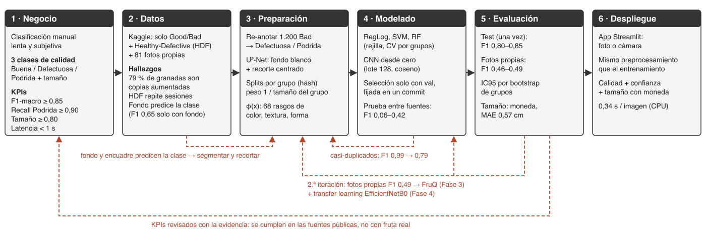

# 🍎 Clasificación Automática de Calidad de Frutas por Visión por Computadora

Proyecto Final — **Algoritmos y Programación III**, Semestre 2026-2
Facultad de Ingeniería, Diseño y Ciencias Aplicadas · Departamento de Computación y Sistemas Inteligentes · Ingeniería de Sistemas.

#### -- Estado del proyecto: `Entregado` ✅

| | |
|---|---|
| 🌐 **App desplegada** | <https://fruit-quality-classification-2026.streamlit.app> |
| 📄 **Informe final (IEEE, 7 págs.)** | [`docs/informe/latex/informe.pdf`](docs/informe/latex/informe.pdf) |
| 🗺️ **CRISP-DM fase por fase** | [`docs/crisp-dm.md`](docs/crisp-dm.md) · [`ROADMAP.md`](ROADMAP.md) |
| 📓 **Notebooks con resultados** | [`notebooks/`](notebooks/) |

---

## 📌 Descripción general

En mercados y agroindustrias, la clasificación manual de fruta fresca según su calidad y tamaño es
**lenta, subjetiva y propensa a errores**, lo que genera pérdidas económicas y desperdicio de
alimentos. Este proyecto desarrolla un sistema de visión por computadora que, a partir de la foto de
**una fruta** sobre fondo simple, entrega:

1. **Calidad** — `Buena`, `Defectuosa` (daño superficial; se come quitando la parte afectada) o
   `Podrida` (moho, tejido blando o hundido, daño oscuro extenso). Criterios en
   [`docs/criterios_anotacion.md`](docs/criterios_anotacion.md).
2. **Tamaño** — `Pequeño`, `Mediano` o `Grande` y el diámetro en cm, usando una moneda en la foto como
   referencia de escala.

El sistema combina el dataset exigido (Fruit Quality Classification / FruitNet) con otras fuentes
públicas y fotos tomadas por el equipo, y sigue la metodología **CRISP-DM** en cuatro iteraciones.



---

## 👥 Integrantes

| Nombre | Rol |
|--------|-----|
| **Juan Manuel Ramírez** | Desarrollo / Modelado |
| **Juan Sebastián Poveda** | Desarrollo / Datos |
| **Samuel José Rengifo** | Desarrollo / Despliegue |

---

## 📈 Resultados principales

F1-macro con IC95 por *bootstrap* de grupos (fotos de la misma fruta no son independientes) y recall
de `Podrida`, el error más costoso. `test` y las fotos propias se evaluaron una sola vez por modelo,
con el modelo fijado antes en un commit.

| Modelo | Validación | Test | Recall Podrida (test) | Fotos propias |
|---|---|---|---:|---|
| Línea base (mayoría) | 0,27 | 0,30 | 0,00 | 0,17 |
| SVM (RBF, 68 rasgos de color/textura/forma) | 0,84 | 0,80 | 0,81 | 0,46 |
| CNN desde cero (341 mil parámetros) | **0,91** | 0,80 | **0,91** | **0,49** |
| EfficientNetB0 (*transfer learning*) — **modelo de la app** | **0,91** | **0,85** | **0,91** | 0,47 |

- **Dentro de las fuentes públicas** el problema queda bien resuelto (F1 0,80–0,85 en test, recall de
  Podrida 0,91).
- **Con fruta real** (fotos del equipo) todos caen a F1 ≈ 0,47: **cambio de dominio** (variedad,
  cámara, luz) y un **umbral de pudrición distinto** entre fuentes, no sobreajuste.
- **Tamaño:** error medio de **0,57 cm** frente a medidas con regla.
- **Latencia:** 0,34 s por imagen en CPU, incluida la segmentación.

### Hallazgos que cambiaron el proyecto

1. **Copias aumentadas:** el 79 % de las granadas de FruitNet son copias de 1.291 fotos únicas.
2. **Casi-duplicados:** con particiones por imagen el SVM llegaba a F1 0,99 en HDF; con particiones
   **por grupo** (misma fruta o sesión) baja a 0,79.
3. **El fondo predice la clase:** solo con el borde de la imagen se obtenía F1 0,65. Se corrigió
   segmentando la fruta con U²-Net y recortándola sobre fondo blanco.

### Iteraciones CRISP-DM

| Iteración | Qué se probó | Resultado |
|---|---|---|
| 1 | ML tradicional + CNN desde cero | CNN val 0,91, test 0,80; fotos propias 0,49 |
| 2 | EfficientNetB0 + FruQ (fuente solo de entrenamiento) | test 0,85; mejora entre fuentes, no con fruta real |
| 3 | Sin imágenes de varias frutas + revisión de etiquetas | **Sin mejora** (κ = 0,29: la frontera Defectuosa/Podrida es el cuello de botella) |
| 4 | Solo manzana, banano y naranja | Recall de Podrida con fruta real 0,30 → 0,48; la app conserva el modelo de 6 frutas |

---

## 🧪 Métodos y modelos

- **ML tradicional** (`src/models/classic_ml.py`): regresión logística, **SVM (RBF)** y Random Forest
  sobre un vector φ(x) de 68 rasgos calculados solo con los píxeles de la fruta (histogramas HSV,
  LBP, GLCM, forma). Hiperparámetros con `GridSearchCV` y 5 pliegues estratificados **por grupo**.
- **CNN desde cero** (`src/models/cnn.py`): 4 bloques Conv-BatchNorm-ReLU-MaxPool, *global average
  pooling*, densa y dropout; lote 128 con tasa coseno.
- **Transfer learning** (`src/models/transfer.py`): EfficientNetB0 preentrenada, cabeza con la base
  congelada y luego ajuste fino.
- **Desbalanceo:** pesos por muestra 1/tamaño del grupo con clases equilibradas.
- **Tamaño** (`src/features/size.py`): moneda detectada (escala), corrección de perspectiva con la
  focal del EXIF y diámetro ecuatorial de la máscara de la fruta.

---

## 📊 Datos

| Fuente | Uso | Licencia / referencia |
|---|---|---|
| [Fruit Quality Classification / FruitNet (Kaggle)](https://www.kaggle.com/datasets/ryandpark/fruit-quality-classification) | train/val/test; `Bad` re-anotado en Defectuosa/Podrida | Meshram y Patil, *Data in Brief*, 2022 |
| [Healthy-Defective-Fruits](https://github.com/luischuquim/Healthy-Defective-Fruits) (HDF, ESPOL), solo imágenes reales | train/val/test | CC BY 4.0 — Pacheco *et al.*, VISAPP 2023 |
| [FruQ](https://zenodo.org/records/7224690) (Zenodo) | solo entrenamiento (2.ª iteración) | CC BY 4.0 — Abayomi-Alli *et al.*, 2023 |
| Fotos propias del equipo, dos lotes ([`data/external/propias/`](data/external/propias/)) | **solo prueba externa** | propias; compartidas con el curso en Google Drive |

- Las fotos propias se anotaron con su calidad según los criterios escritos; el tamaño se anotó en
  fotos aparte con una moneda de referencia y el diámetro medido con regla.
- Los datos de terceros y los modelos **no se versionan** (ver `.gitignore`); solo las fotos propias.
  Los modelos finales se publican en la release
  [`modelos-v1`](https://github.com/sjrengifo/fruit-quality-classification/releases/tag/modelos-v1).

---

## 🚀 Uso

**Probar la app sin instalar nada:** <https://fruit-quality-classification-2026.streamlit.app> —
subir una o varias fotos o capturarlas con la cámara (también desde el celular). Para medir el
tamaño, activar la opción en la barra lateral y poner una moneda junto a la fruta.

**En local** (Python 3.12):

```bash
git clone https://github.com/sjrengifo/fruit-quality-classification.git
cd fruit-quality-classification
python -m venv .venv && source .venv/bin/activate   # Windows: .venv\Scripts\activate
pip install -r requirements.txt

streamlit run src/app/app.py                 # la app descarga los modelos de la release la primera vez
python -m src.models.predict foto.jpg        # predicción desde la terminal
pytest                                       # pruebas
```

Para **reproducir el pipeline** completo (descarga de datos, segmentación, entrenamiento y
evaluación) ver [`docs/instalacion.md`](docs/instalacion.md).
Las redes se entrenaron en Google Colab (GPU T4) con
[`notebooks/colab_entrenar_cnn`](notebooks/colab_entrenar_cnn.ipynb).

---

## 📓 Notebooks (trazabilidad por fase)

| Notebook | Fase CRISP-DM | Contenido |
|---|---|---|
| [`01_eda`](notebooks/01_eda.ipynb) | 2. Comprensión de los datos | Distribución de clases, desbalanceo, propiedades de las imágenes |
| [`02_preprocessing`](notebooks/02_preprocessing.ipynb) | 3. Preparación | 3 clases, grupos y splits, segmentación, atajos, rasgos, revisión de etiquetas, fotos nuevas |
| [`03_modeling_ml`](notebooks/03_modeling_ml.ipynb) | 4. Modelado | Regresión logística, SVM, Random Forest, rejillas, ablación |
| [`04_modeling_cnn`](notebooks/04_modeling_cnn.ipynb) | 4. Modelado | CNN, transfer learning, generalización entre fuentes, **tabla de todos los entrenamientos** |
| [`colab_entrenar_cnn`](notebooks/colab_entrenar_cnn.ipynb) | 4. Modelado | Entrenamiento en GPU e historial de corridas |
| [`05_evaluation`](notebooks/05_evaluation.ipynb) | 5. Evaluación | Test y fotos propias con IC95, errores, sobreajuste, iteraciones 2–4 |

---

## 📂 Estructura del repositorio

```
fruit-quality-classification/
├── README.md · ROADMAP.md · requirements.txt · environment.yml · LICENSE
├── docs/
│   ├── crisp-dm.md              # cada fase de CRISP-DM con sus decisiones y resultados
│   ├── criterios_anotacion.md   # definición de Buena / Defectuosa / Podrida
│   ├── etica.md                 # dilemas éticos e impactos
│   ├── formulacion_matematica.md
│   ├── arquitectura.md · instalacion.md
│   └── informe/                 # informe final: latex/informe.pdf (fuente: latex/informe.tex)
├── src/
│   ├── config.py                # rutas, clases, hiperparámetros, modelos finales
│   ├── data/                    # descarga, índice, preprocesamiento, segmentación, splits, re-anotación
│   ├── features/                # rasgos φ(x) y estimación de tamaño
│   ├── models/                  # ML clásico, CNN, transfer learning, predicción
│   ├── training/                # entrenamiento, búsquedas y paquete para Colab
│   ├── evaluation/              # métricas con IC95, atajos, ablación, figuras
│   └── app/                     # app Streamlit (y herramienta de anotación)
├── notebooks/                   # trazabilidad por fase (.py jupytext + .ipynb ejecutado)
├── data/                        # datos (solo data/external/propias/ y data/anotaciones/ se versionan)
├── experiments/                 # checkpoints, resultados y logs (no versionados)
├── assets/                      # figuras por fase (SVG + PNG)
└── tests/                       # pruebas (pytest)
```

---

## 📦 Entregables

- [x] Repositorio organizado por fases CRISP-DM.
- [x] Informe final (7 págs., formato IEEE) — [`docs/informe/latex/informe.pdf`](docs/informe/latex/informe.pdf).
- [x] Interfaz de despliegue funcional (Streamlit) — <https://fruit-quality-classification-2026.streamlit.app>.
- [x] Análisis ético y de impactos (informe §VI y [`docs/etica.md`](docs/etica.md)).
- [ ] Video de presentación (≤ 10 min).

---

## 📄 Licencia

Código bajo [GPL-2.0](LICENSE). Los datasets de terceros conservan sus licencias y deben citarse
según la tabla de datos.
