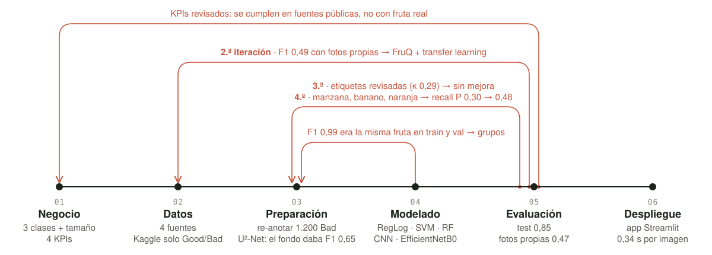
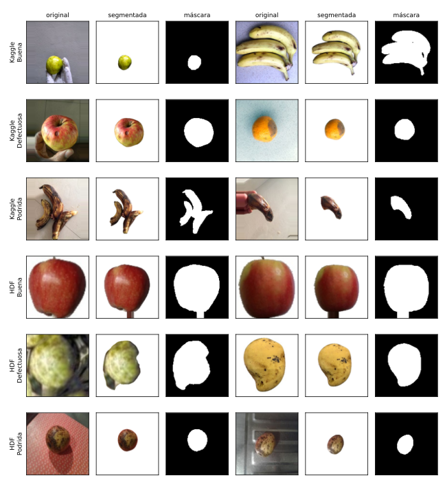
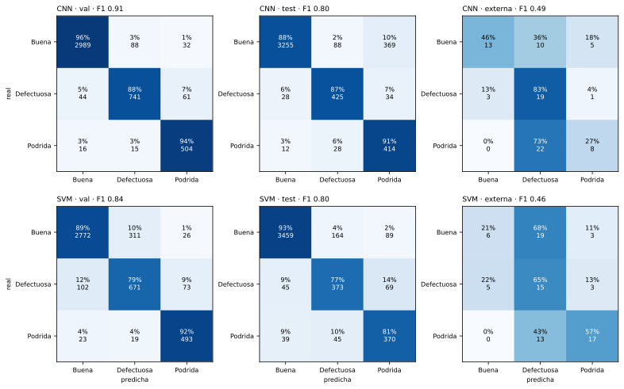

# Clasificación de la calidad y estimación del tamaño de frutas por visión por computador: atajos, fuga de datos y cambio de dominio

**Autores:** Juan Manuel Ramírez, Juan Sebastian Poveda, Samuel Jose Rengifo
**Curso:** Algoritmos y Programación III, 2026-2 · Repositorio: _[enlace de GitHub]_

> Borrador de contenido. **La versión oficial es la de LaTeX** (`docs/informe/latex/informe.tex` →
> `informe.pdf`, clase IEEEtran, 6 páginas); los cambios se hacen allí. Las cifras salen de
> `docs/crisp-dm.md` y de `experiments/results/`.

---

## Resumen

**Problema.** La clasificación manual de fruta fresca es lenta, subjetiva y propensa a errores. Este
trabajo desarrolla un sistema que, a partir de una foto de una fruta, predice su calidad (Buena,
Defectuosa o Podrida) y estima su tamaño (Pequeño, Mediano o Grande).

**Datos.** La base pedida, FruitNet [3], solo distingue Good/Bad. Se re-anotaron 1.200 imágenes Bad,
se agregaron dos fuentes públicas [4], [5] y 81 fotos propias como prueba externa.

**Hallazgos sobre los datos.** Tres problemas inflaban las métricas: copias aumentadas, sesiones de
fotos repetidas y un fondo que predecía la clase (F1 0,65 viendo solo el borde de la imagen). Se
corrigieron con particiones por grupos y con segmentación U²-Net [6].

**Modelos.** Se compararon regresión logística, SVM y Random Forest sobre 68 rasgos de color, textura
y forma, una CNN entrenada desde cero y EfficientNetB0 con *transfer learning* [7].

| Conjunto | Mejor F1-macro | Modelo |
|----------|---------------:|--------|
| Validación | 0,91 | CNN |
| Prueba | 0,85 | EfficientNetB0 |
| Fotos propias | 0,46–0,49 | todos los modelos |

**Por qué fallan con fruta real.** La caída se explica por cambio de dominio y por un umbral de
pudrición distinto entre fuentes, no por sobreajuste.

**Tamaño.** Se mide con una moneda como escala y corrección de perspectiva. El error medio es de
0,57 cm en 11 frutas medidas con regla.

**Despliegue.** Una aplicación Streamlit responde en 0,34 s por imagen en CPU.

*Palabras clave:* clasificación de calidad de frutas, CNN, *transfer learning*, fuga de datos, cambio de dominio, CRISP-DM.

---

## I. Introducción

**El problema.** En plazas de mercado y agroindustrias, la fruta se separa a mano por calidad y
tamaño. El proceso es lento, depende del operario y de su cansancio, y tiene costo: la FAO estima que
cerca del 14 % de los alimentos se pierde entre la cosecha y la venta minorista [1]. El PNUMA calcula
que otro 17 % se desperdicia en venta y consumo [2]. Las frutas están entre los productos más
afectados porque se dañan rápido. Un sistema de visión por computador barato (celular o cámara web
más software) puede apoyar esa inspección, siempre que sea confiable con fruta real y no solo con el
dataset de entrenamiento.

**Objetivo.** Dada una foto de una fruta sobre fondo simple, el sistema debe:
- predecir su calidad en tres clases: **Buena**, **Defectuosa** (golpes o manchas superficiales; apta
  con reservas) y **Podrida** (no apta);
- estimar su tamaño: Pequeño, Mediano o Grande.

**Criterios de éxito (fijados en la Fase 1):**
- F1-macro ≥ 0,85.
- Recall de Podrida ≥ 0,90. Dejar pasar fruta podrida es el error más costoso.
- Exactitud de tamaño ≥ 0,80.
- Latencia < 1 s por imagen en CPU.

**Contribuciones:**
1. Un diagnóstico de tres fuentes de métricas infladas en los datasets públicos (copias aumentadas,
   casi-duplicados y atajos de fondo y encuadre), con sus correcciones.
2. Una comparación honesta de ML clásico, una CNN desde cero y *transfer learning* en tres
   escenarios: las mismas fuentes, una fuente no vista y fotos propias.
3. Una medición de tamaño con referencia física, validada contra regla.

---

## II. Fundamentos teóricos

**Rasgos diseñados a mano.**
- El **color** se resume con histogramas en HSV. Ese espacio separa el tono (H) de la iluminación (V),
  y el tono es lo que cambia con la pudrición.
- La **textura** se describe con patrones binarios locales (LBP) [15] y con la matriz de co-ocurrencia
  de niveles de gris (GLCM) [16]. Ambos capturan manchas, moho y arrugas.
- La **forma** se describe con circularidad, solidez y los momentos de Hu.

**SVM** [14]. Busca el hiperplano de margen máximo en un espacio inducido por un kernel. Con el kernel
RBF separa clases que no son linealmente separables en φ(x).

**CNN.** Encadena convoluciones que aprenden filtros locales, *pooling* que reduce la resolución y una
capa softmax final. *Batch normalization* [8] estabiliza el entrenamiento. El optimizador es Adam [9]
con tasa de aprendizaje de decaimiento coseno [10].

**Transfer learning.** Reutiliza una red preentrenada en ImageNet, aquí EfficientNetB0 [7]. Primero se
entrena solo la cabeza nueva y después se ajusta toda la red con una tasa baja.

**Aprendizaje por atajos** [11]. Una red aprende la regla más fácil que separa las clases en el
entrenamiento, aunque no sea la causa real: por ejemplo, el fondo en lugar de la fruta. Esa regla deja
de funcionar fuera de esa distribución.

**Generalización de dominio** [12]. Entrenar con varias fuentes no garantiza funcionar en una fuente
nueva. En los estudios comparativos, minimizar el error promedio de entrenamiento (ERM) sigue siendo
difícil de superar.

---

## III. Metodología

El proyecto siguió CRISP-DM con dos iteraciones. La Fig. 1 muestra las fases y las
retroalimentaciones reales: cada flecha roja corresponde a un hallazgo que obligó a volver atrás.

*Fig. 1. CRISP-DM aplicado al proyecto. Cada arco es un retroceso real motivado por
hallazgos concretos.*

### A. Formulación matemática

**Notación.**
- Imagen de entrada: $x\in\{0,\dots,255\}^{H\times W\times 3}$.
- Clase de calidad: $y\in\{1,2,3\}$.
- Grupo de origen de la imagen (misma foto o misma sesión de captura): $g(x)$.

**Calidad.** Se busca $f_\theta$ tal que la salida softmax $p_k=e^{z_k}/\sum_j e^{z_j}$ aproxime
$P(y=k\mid x)$. La pérdida es una entropía cruzada **ponderada por grupo y clase**:

$$\mathcal{L}(\theta)=-\frac{1}{\sum_i w_i}\sum_{i=1}^{N} w_i\log p_{i,y_i}+\lambda\lVert\theta\rVert_2^2,\qquad w_i\propto\frac{1}{|g_i|},\ \ \sum_{i:\,y_i=k}w_i=\tfrac{N}{3}\ \forall k.$$

Con estos pesos, 30 copias de una foto cuentan como una sola y las tres clases pesan lo mismo. Es el
único mecanismo contra el desbalanceo (5:1 entre Buena y las otras clases).

**Por qué no SMOTE.** Interpolar rasgos de frutas distintas no produce frutas plausibles; los pesos
logran lo mismo sin datos sintéticos.

**Métrica principal.** El F1-macro $\frac{1}{3}\sum_k \frac{2P_kR_k}{P_k+R_k}$. Se prefiere a la
exactitud porque, con este desbalanceo, la clase mayoritaria sola ya alcanza 0,69 de exactitud.

**Incertidumbre.** Se estima con *bootstrap* de **grupos** (2.000 remuestreos) [18]:
- se remuestrean grupos y no imágenes, porque las imágenes de un mismo grupo no son independientes;
- para comparar dos modelos se usa la diferencia pareada sobre las mismas muestras de grupos.

**Tamaño.** Sea $D_m$ el diámetro de la moneda en píxeles.
1. **Escala:** $s=D_m/26{,}7$ px/mm. La moneda de \$1.000 mide 26,7 mm.
2. **Altura de la cámara**, a partir de la focal equivalente $f_{35}$ guardada en el EXIF:
   $H=f_{35}\,\delta_{px}/(43{,}27\,s)$, con $\delta_{px}$ la diagonal de la imagen.
3. **Diámetro corregido.** La fruta se modela como una esfera de radio $r$ apoyada en la mesa. Su
   contorno visto desde la cámara corta la mesa a una semianchura
   $a=H\tan\!\big(\arcsin\frac{r}{H-r}\big)$. Despejando, con $\sigma=a/\sqrt{H^2+a^2}$:
   $$r=\frac{H\sigma}{1+\sigma}.$$
4. **Clase.** El diámetro $2r$ se compara con umbrales por fruta $(t_1,t_2)$ tomados de calibres
   comerciales: Pequeño si $2r<t_1$, Mediano si $2r<t_2$ y Grande en otro caso.

**Por qué es un problema complejo de ingeniería:**
- la entrada tiene 49.152 dimensiones (128×128×3);
- la frontera Buena/Defectuosa/Podrida es sutil, no lineal y subjetiva;
- hay seis especies con apariencias distintas;
- los datos tienen fugas y atajos ocultos (§III-B);
- el uso real ocurre en un dominio distinto al de entrenamiento (fruta, cámara y luz).

### B. Datos y hallazgos

**Fuentes** (Tabla I):
- **FruitNet** [3] (Kaggle, base exigida) solo trae Good/Bad, y Bad mezcla defectos leves con
  pudrición. Se re-anotó una muestra fija de **1.200 Bad** (200 por fruta, semilla 42) según criterios
  escritos: 842 → Podrida, 211 → Defectuosa, 13 → Buena y 134 descartadas.
- **Healthy-Defective-Fruits (HDF)** [4]: se usaron solo las imágenes reales de manzana y mango. Aporta
  las tres clases desde una segunda fuente.
- **Regla de diseño:** las tres clases deben provenir de las mismas fuentes; si no, el modelo aprende la
  fuente en lugar de la calidad.
- **Fotos propias:** el equipo tomó **81** sobre fondo blanco (28 Buena, 23 Defectuosa, 30 Podrida).
  Se reservaron como prueba externa y nunca se usaron para entrenar ni para elegir modelos.

*Tabla I. Imágenes por fuente y clase (después de excluir 1.292 imágenes en escala de grises).*

| Fuente | Buena | Defectuosa | Podrida | Uso |
|--------|------:|-----------:|--------:|-----|
| FruitNet (Kaggle) | 10.489 | 211 | 842 | train/val/test |
| HDF (reales) | 4.909 | 2.987 | 2.000 | train/val/test |
| FruQ [5] | 596 | 325 | 594 | solo train (2.ª iteración) |
| Propias | 28 | 23 | 30 | prueba externa |

**Hallazgo 1: copias aumentadas.** El 79 % de las granadas de FruitNet son copias aumentadas de 1.291
fotos únicas. El desbalanceo de granada que mostró el EDA era artificial. Si una copia cae en
entrenamiento y otra en prueba, la prueba mide memoria.

**Hallazgo 2: casi-duplicados.** HDF repite la misma fruta o sesión cientos de veces: las 2.500 manzanas
frescas salen de unas 12 sesiones.
- Con particiones por imagen, el SVM obtenía **F1 0,99 en HDF**.
- Se agruparon las imágenes con histograma HSV casi idéntico (distancia L1 < 0,25, enlace simple).
  HDF pasó de 9.896 grupos a 1.298, y el F1 bajó a **0,79**, la cifra honesta.
- Las particiones (≈ 60/20/20) se asignan **por hash del grupo**. Así son estables: al agregar datos,
  ninguna imagen cambia de partición.

**Hallazgo 3: el fondo y el encuadre predicen la clase.** Una regresión logística que solo ve un
anillo de 10 px del borde de la imagen obtuvo F1 **0,65** (azar: 0,34), y 0,76 en HDF. Por ejemplo, en
HDF las Buena están recortadas sobre blanco y las Defectuosa sobre fondo negro o en el árbol.
- **Corrección:** U²-Net [6] separa la fruta, el fondo se reemplaza por blanco y la caja de la fruta se
  recorta a 128×128.
- **Verificación:** después de la corrección, el fondo solo da 0,18 (por debajo del azar) y la silueta
  sin color baja de 0,64 a 0,37 en HDF.

**Preprocesamiento.** Es el mismo en entrenamiento y en la aplicación: orientación EXIF → RGB → lado
mayor a la resolución de trabajo sin deformar → relleno replicando el borde → segmentación → recorte.

*Fig. 2. Imágenes originales y después de segmentar y recortar.*

### C. Modelos y selección

**Protocolo.**
- Se entrena con *train* y se elige con *val*.
- *Test* y las fotos propias se abren una sola vez, con el modelo ya fijado en un *commit*
  (`d7b6928` y `8818bb0`).

**ML clásico.**
- Entrada: φ(x) ∈ ℝ⁶⁸, calculado solo sobre los píxeles de la fruta: color (38), textura LBP + GLCM
  (18) y forma (12).
- Ajuste: `GridSearchCV` con F1-macro y 5 pliegues **estratificados por grupo**. El escalado va dentro
  del *pipeline* para no filtrar estadísticas de validación.
- Mejor SVM: RBF con C = 100 y γ = *scale*.

**CNN desde cero (341 mil parámetros):**
- Arquitectura: 4 bloques [Conv 3×3 → BatchNorm → ReLU → MaxPool] con 32, 64, 128 y 192 filtros →
  GlobalAveragePooling → Dense(128) → Dropout(0,4) → softmax.
- *Global average pooling* en lugar de *flatten* reduce los parámetros de ~4 M a 341 mil.
- **Inestabilidad:** el primer entrenamiento (lote 32) oscilaba ±0,1 de F1 entre épocas, así que
  elegir la mejor época era optimista. La causa era el gradiente ruidoso con pesos muy desiguales.
- **Solución:** con lote 128 y tasa coseno, la desviación del F1 en las últimas 5 épocas bajó a ±0,007.
- **Aumento de datos:** sin aumento fue mejor en dos búsquedas independientes (+0,02 a +0,04, IC95
  sin cero).

**Segunda iteración.** Las fotos propias mostraron la falla de dominio (§IV). Para atacarla sin tocar
esas 81 fotos:
- **EfficientNetB0** [7]: 3 épocas entrenando solo la cabeza y 15 de ajuste fino con tasa coseno desde
  1e-4.
- **FruQ** [5]: *time-lapses* de una sola fruta que pasa de fresca a podrida, usados solo para
  entrenar.
- **Criterio de selección, fijado antes de entrenar:** validación más una prueba **dejando una fuente
  fuera** (entrenar sin Kaggle o sin HDF y validar en la fuente excluida).
- **Elegido:** aumento de color + FruQ.

---

## IV. Resultados

**Comparación de modelos** (Tabla II):
- Los cinco modelos superan con amplitud la línea base de mayoría (F1 0,27 en *val*).
- La CNN y EfficientNet empatan en validación (diferencia pareada −0,00, IC95 [−0,04; +0,03]) y
  superan al SVM (+0,07, IC95 [+0,01; +0,12]).
- La exactitud es mayor que el F1 porque Buena domina.

*Tabla II. F1-macro [IC95 por grupos] y recall de Podrida (R_P). Test y fotos propias se evaluaron una
vez por modelo.*

| Modelo | Val | Test | R_P test | Fotos propias | R_P propias |
|--------|-----|------|---------:|---------------|------------:|
| Mayoría | 0,27 | 0,30 | 0,00 | 0,17 | 0,00 |
| Regresión logística | 0,76 | — | — | — | — |
| Random Forest | 0,84 | — | — | — | — |
| SVM (RBF) | 0,84 [0,73; 0,92] | 0,80 [0,73; 0,87] | 0,81 | 0,46 [0,35; 0,56] | 0,57 |
| CNN desde cero | **0,91** [0,85; 0,95] | 0,80 [0,68; 0,93] | **0,91** | **0,49** [0,37; 0,59] | 0,27 |
| EfficientNetB0 (TL) | **0,91** [0,85; 0,96] | **0,85** [0,76; 0,94] | **0,91** | 0,47 [0,36; 0,57] | 0,30 |

**Ablación de rasgos (SVM, F1 en *val*):**

| Rasgos | F1 |
|--------|---:|
| Solo color | 0,75 |
| Solo textura | 0,74 |
| Solo forma | 0,56 |
| Color + textura + forma | 0,84 |

**Generalización entre fuentes** (Tabla III):
- Un SVM entrenado solo con HDF obtiene **0,06** en Kaggle.
- *Transfer learning* mejora a la CNN en la fuente no vista. La mejora es significativa al validar en
  Kaggle (+0,11, IC95 [+0,08; +0,14]); al validar en HDF el IC95 es ancho.

*Tabla III. F1-macro en la fuente excluida del entrenamiento.*

| Modelo | Entrena Kaggle → valida HDF | Entrena HDF → valida Kaggle |
|--------|----------------------------:|----------------------------:|
| SVM | 0,42 | 0,06 |
| CNN desde cero | 0,49 | 0,36 |
| TL + color + FruQ | 0,61 | 0,47 |

*Fig. 3. Matrices de confusión en test y en fotos propias.*

**Tamaño** (11 frutas medidas con regla):
- La moneda se detectó en 11/11 fotos, y su escala coincide con la de una regla visible en cada foto
  (2–3 %).
- Error medio absoluto: **0,57 cm**; sesgo: +0,38 cm.
- Clase de tamaño correcta: 5/11.
- La primera versión medía el ancho máximo, que incluye las puntas del limón y el pedúnculo, y daba
  1,10 cm de error. Se cambió al **diámetro ecuatorial**, que es el calibre de las normas comerciales
  [19].

**Latencia.** 0,34 s por imagen en CPU (Apple M4) con EfficientNet, incluyendo la segmentación; 0,37 s
con la medición de tamaño.

---

## V. Análisis de resultados

**¿Sobreajuste?** No en las redes:
- CNN: F1 0,91 en *train* y 0,91 en *val*. Los pesos por grupo impiden memorizar sesiones repetidas.
- SVM: memoriza (1,00 en *train* frente a 0,84 en *val*); la validación cruzada por grupos acota ese
  efecto.

**Caída de validación a test (0,91 → 0,80 en la CNN).** No es sobreajuste. 306 de los 369 errores
Buena → Podrida vienen de una sola sesión de HDF: manzanas Red Delicious de rojo muy oscuro, que la red
asocia con pudrición.
- Contando cada fruta una vez, la CNN vuelve a 0,90. Ojo: esta métrica se decidió después de ver test y
  se reporta solo como diagnóstico.
- EfficientNet, preentrenada con millones de imágenes naturales, reduce esos errores de 358 a 66. Es el
  único cambio claro que aporta en test.

**Fotos propias (F1 ≈ 0,47 en los tres modelos).** Los tres modelos fallan juntos:
- La CNN y EfficientNet coinciden en el 62 % de las fotos y fallan a la vez en el 35 %. Con
  arquitecturas tan distintas (68 rasgos frente a 4 M de parámetros), esto indica que **el límite está
  en los datos, no en el modelo**.
- **Error dominante:** Podrida → Defectuosa (20 de 30).
  - 12 de esos errores son manzanas con manchas marrones moderadas. Están en la frontera de nuestro
    criterio y son más leves que las Podrida de HDF, que muestran pudrición extensa.
  - 5 son naranjas con moho evidente, un caso casi ausente en el entrenamiento.
- Ese error es el más costoso. Las causas son dos:
  1. **Cambio de dominio:** variedad, cámara y luz distintas, coherente con la Tabla III.
  2. **El umbral de pudrición difiere** entre las fuentes públicas y nuestro criterio.
- Ninguna de las dos se corrige con más capacidad del modelo.

**Lectura útil del resultado.** Como detector de "fruta dañada frente a buena", EfficientNet detecta 49
de las 53 frutas dañadas propias. Clasificó bien solo 13 de las 28 Buena, de modo que serviría como
primer filtro con revisión humana, no como clasificador autónomo de tres clases.

**Tercera iteración: ¿son las etiquetas?**
- Para probar el umbral de pudrición como causa se excluyeron 1.816 imágenes con varias frutas (casi
  todas Kaggle `Buena`, un atajo posible) y se revisaron a ciegas 2.522 grupos con nuestro criterio.
  La revisión la hizo **un modelo de IA (Claude)** a pedido del equipo, por falta de tiempo.
- Acuerdo con la re-anotación previa de Kaggle: κ = 0,29. La revisión hizo Podrida *más* exigente
  (945 imágenes Podrida → Defectuosa).
- Reentrenados desde cero con la misma configuración, no mejoraron con las fotos propias (tercera
  mirada): CNN 0,49 → 0,38 (diferencia pareada +0,11 [0,003; 0,22]); EfficientNetB0 0,47 → 0,52
  (−0,05 [−0,15; 0,06]); 21 de 30 Podrida siguen como Defectuosa.
- Resultado negativo: el límite es la **definición operativa de Podrida**, no los datos ni el modelo.

**Cuarta iteración: menos frutas.**
- Solo manzana, banano y naranja (el daño contrasta con la piel), evaluado con 35 fotos nuevas (no
  vistas) y con las 62 anteriores de esas frutas.
- Fotos nuevas: los tres modelos detectan 5–6 de 6 podridas como dañadas y reconocen 20–21 de 26
  buenas; sin diferencias demostrables.
- Fotos anteriores: recall de Podrida 0,30 → 0,48 (+0,19 [0,04; 0,34]) al recortar el alcance; con
  etiquetas revisadas, F1 0,42 → 0,51 (IC toca el cero).
- Es una mejora de **alcance**, no un modelo mejor para las seis frutas; la aplicación conserva el
  modelo de seis frutas.

**Comparación con la literatura:**
- Con FruitNet, Morshed et al. [13] reportan 99,67 % de exactitud en 3 niveles de calidad. Usan una
  partición 60:20:20 cuyo método no se detalla y no mencionan las copias aumentadas.
- Pacheco et al. [4] reportan 97,5 % en manzanas de HDF con MobileNetV2.
- Nuestras cifras no son comparables directamente: con partición por imagen, nuestro SVM también
  llegaba a 0,96 global y 0,99 en HDF, y al agrupar copias y sesiones bajó a 0,84 y 0,79.
- Esto no prueba que esos trabajos tengan fuga de datos. Muestra que en estos datasets **la forma de
  partir los datos cambia el resultado más que la arquitectura**.
- La falla entre fuentes coincide con lo reportado en generalización de dominio [12]: ERM con varias
  fuentes no garantiza funcionar en una fuente nueva.
- El atajo de fondo es un caso concreto del aprendizaje por atajos [11].

**Tamaño.** La escala (moneda) no es la fuente del error: coincide con la regla en 2–3 %.
- **Límites de la validación:**
  - El error de 0,57 cm es del mismo orden que el ancho de los rangos de limón (1 cm). Con frutas cerca
    de un umbral, la clase falla con facilidad.
  - Las medidas con regla tienen ruido visible: el limón anotado en 3,8 cm se ve más grande que otro
    anotado en 4,5 cm.
  - El cambio a diámetro ecuatorial se decidió después de ver estas 11 frutas, así que el 0,57 cm es
    optimista.
- **Por qué no se entrenó un modelo de tamaño:** una foto sin referencia no tiene escala absoluta (la
  misma fruta se ve grande de cerca), y ningún dataset trae tamaños reales. Una medición geométrica con
  referencia física es más defendible que un modelo entrenado sin esa información.

---

## VI. Ética e impactos

Las decisiones se relacionan con el Código de Ética de la ACM [20]; el detalle está en
`docs/etica.md`.

*Tabla IV. Dilemas éticos y medidas adoptadas.*

| Situación | Dilema | Principio ACM | Medida adoptada |
|-----------|--------|---------------|-----------------|
| Fotos propias en casa y mercado | Privacidad, captura de personas | 1.6 Privacidad | Solo la fruta sobre fondo blanco, sin personas; las 104 fotos versionadas no tienen GPS en el EXIF (verificado) |
| Datasets de terceros | Atribución, licencias | 1.5 Reconocer el trabajo ajeno | Fuentes y código de terceros citados; HDF y FruQ (CC BY 4.0) con atribución; el repositorio solo versiona fotos propias |
| Métricas infladas (copias, atajos) | Reportar la cifra que favorece al proyecto | 1.3 Honestidad; 2.5 Evaluación completa | Particiones por grupo; test abierto una vez; se reporta F1 0,47 con fruta real |
| Error Podrida → Buena | Riesgo para el consumidor | 1.2 Evitar daño | KPI de recall de Podrida; confianza visible en la app; uso como filtro con revisión humana |
| Sesgo por variedad y fuente | Peor desempeño en fruta local | 1.4 Equidad | Análisis por fuente y por fruta; limitación declarada |
| Automatizar la clasificación | Desplazamiento laboral | 1.1 Bienestar social | Herramienta asistiva, el operario decide |
| Etiquetas subjetivas | Criterio de un solo anotador | 2.5 | Criterios escritos; kappa entre anotadores _[pendiente]_ |

*Tabla V. Matriz de impactos y mitigación.*

| Dimensión | Impacto positivo | Riesgo | Mitigación |
|-----------|------------------|--------|------------|
| Social | Criterio uniforme; menos trabajo repetitivo | Confianza excesiva en un modelo que falla con fruta real | Mostrar la confianza; revisión humana de casos dudosos |
| Económica | Menos merma por fruta buena descartada | Descartar fruta buena (15 de 28 Buena propias se marcaron dañadas) | Calibrar con fotos locales antes de usar |
| Ambiental | Menos desperdicio de alimentos [1], [2] | Energía de la inferencia | Modelos pequeños (341 mil parámetros); CPU, sin GPU |
| Global | Herramienta barata para mercados pequeños | Datasets de otras regiones (India, Ecuador) | Recolectar datos locales; reportar el desempeño por dominio |

---

## VII. Conclusiones y trabajo futuro

**Qué se hizo.** Se construyó un sistema completo, de los datos a la aplicación, para clasificar la
calidad de fruta en tres clases y estimar su tamaño, siguiendo CRISP-DM con dos iteraciones, una tercera de diagnóstico (revisión de etiquetas, resultado negativo) y una cuarta de alcance (3 frutas, mejora modesta en la detección de pudrición).

**Calidad: el desempeño depende del conjunto evaluado.**
- **Dentro de las fuentes públicas:** la CNN desde cero y EfficientNet alcanzan F1 0,91 en validación
  y 0,80–0,85 en test, con recall de Podrida de 0,91. Cumplen el KPI de recall; el de F1 lo cumple
  EfficientNet en test.
- **Con fruta real:** los tres enfoques caen a F1 ≈ 0,47. No cumplen los KPIs y **no son aptos para uso
  autónomo**.

**Lo aprendido.**
- En datasets públicos de calidad de fruta, las copias, los casi-duplicados y los fondos correlacionados
  inflan las métricas. Una partición por grupos y una prueba externa son indispensables.
- Elegir la arquitectura importa menos que el dominio y el criterio de etiquetado: *transfer learning*
  mejora la generalización entre fuentes, pero no cierra la brecha con fruta real.

**Tamaño.** La medición con moneda tiene un error de 0,57 cm. La clase de tamaño no alcanza el KPI
(5/11), sobre todo por los umbrales y por medidas de referencia ruidosas.

**Trabajo futuro**, en orden de impacto esperado:
1. Fotografiar más fruta local y usar parte para entrenar o ajustar.
2. Alinear el umbral Defectuosa/Podrida de las fuentes públicas con el criterio propio.
3. Agregar ejemplos de moho en cítricos.
4. Agregar una salida de rechazo ("no sé") para imágenes fuera de dominio.
5. Calibrar los umbrales de tamaño con frutas medidas con calibrador.
6. Medir el acuerdo entre anotadores (kappa de Cohen [17]).

---

## Referencias

[1] FAO, *The State of Food and Agriculture 2019: Moving Forward on Food Loss and Waste Reduction*. Roma, Italia: FAO, 2019.

[2] UNEP, *Food Waste Index Report 2021*. Nairobi, Kenia: United Nations Environment Programme, 2021.

[3] V. Meshram y K. Patil, "FruitNet: Indian fruits image dataset with quality for machine learning applications," *Data in Brief*, vol. 40, art. 107686, 2022, doi: 10.1016/j.dib.2021.107686.

[4] R. Pacheco, P. González, L. Chuquimarca, B. Vintimilla y S. Velastin, "Fruit defect detection using CNN models with real and virtual data," en *Proc. 18th Int. Joint Conf. Computer Vision, Imaging and Computer Graphics Theory and Applications (VISAPP)*, 2023, pp. 272–279, doi: 10.5220/0011679800003417.

[5] O. O. Abayomi-Alli, R. Damaševičius, S. Misra y A. Abayomi-Alli, "FruitQ: a new dataset of multiple fruit images for freshness evaluation," *Multimedia Tools and Applications*, 2023, doi: 10.1007/s11042-023-16058-6.

[6] X. Qin, Z. Zhang, C. Huang, M. Dehghan, O. R. Zaiane y M. Jagersand, "U²-Net: Going deeper with nested U-structure for salient object detection," *Pattern Recognition*, vol. 106, art. 107404, 2020.

[7] M. Tan y Q. V. Le, "EfficientNet: Rethinking model scaling for convolutional neural networks," en *Proc. 36th Int. Conf. Machine Learning (ICML)*, 2019, pp. 6105–6114.

[8] S. Ioffe y C. Szegedy, "Batch normalization: Accelerating deep network training by reducing internal covariate shift," en *Proc. 32nd Int. Conf. Machine Learning (ICML)*, 2015, pp. 448–456.

[9] D. P. Kingma y J. Ba, "Adam: A method for stochastic optimization," en *Proc. Int. Conf. Learning Representations (ICLR)*, 2015.

[10] I. Loshchilov y F. Hutter, "SGDR: Stochastic gradient descent with warm restarts," en *Proc. Int. Conf. Learning Representations (ICLR)*, 2017.

[11] R. Geirhos *et al.*, "Shortcut learning in deep neural networks," *Nature Machine Intelligence*, vol. 2, pp. 665–673, 2020.

[12] I. Gulrajani y D. Lopez-Paz, "In search of lost domain generalization," en *Proc. Int. Conf. Learning Representations (ICLR)*, 2021.

[13] M. S. Morshed, S. Ahmed, T. Ahmed, M. U. Islam y A. B. M. A. Rahman, "Fruit quality assessment with densely connected convolutional neural network," arXiv:2212.04255, 2022.

[14] C. Cortes y V. Vapnik, "Support-vector networks," *Machine Learning*, vol. 20, no. 3, pp. 273–297, 1995.

[15] T. Ojala, M. Pietikäinen y T. Mäenpää, "Multiresolution gray-scale and rotation invariant texture classification with local binary patterns," *IEEE Trans. Pattern Anal. Mach. Intell.*, vol. 24, no. 7, pp. 971–987, 2002.

[16] R. M. Haralick, K. Shanmugam e I. Dinstein, "Textural features for image classification," *IEEE Trans. Syst., Man, Cybern.*, vol. SMC-3, no. 6, pp. 610–621, 1973.

[17] J. Cohen, "A coefficient of agreement for nominal scales," *Educational and Psychological Measurement*, vol. 20, no. 1, pp. 37–46, 1960.

[18] B. Efron y R. J. Tibshirani, *An Introduction to the Bootstrap*. Nueva York, NY, EE. UU.: Chapman & Hall, 1993.

[19] Codex Alimentarius, *Standard for Apples*, CXS 299-2010. Roma, Italia: FAO/OMS, 2010.

[20] ACM, *ACM Code of Ethics and Professional Conduct*, 2018. [En línea]. Disponible: https://www.acm.org/code-of-ethics
